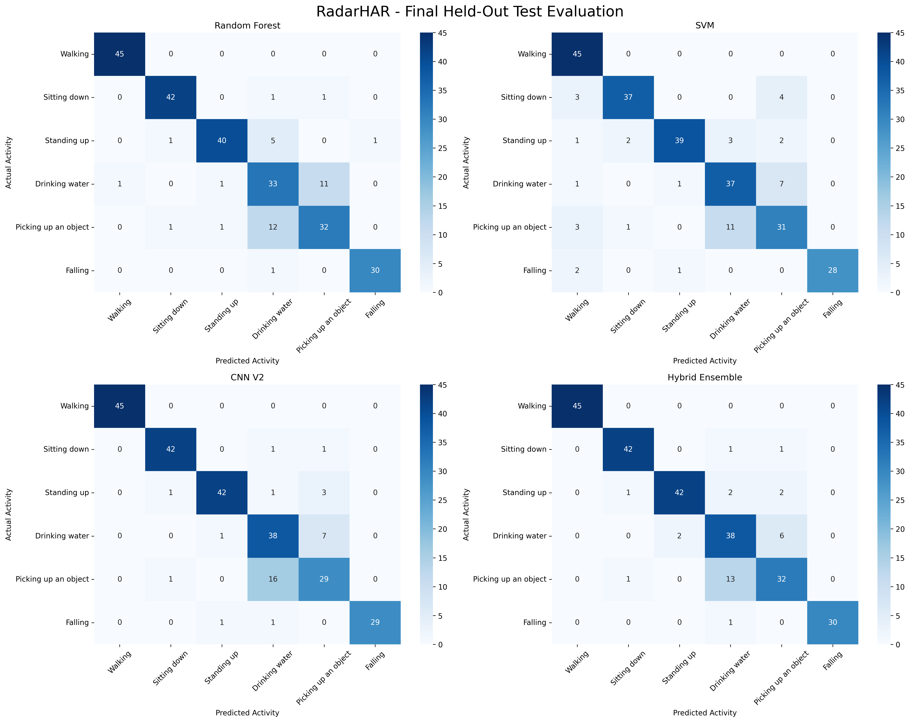
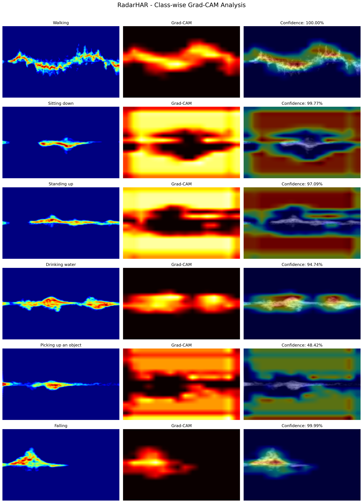
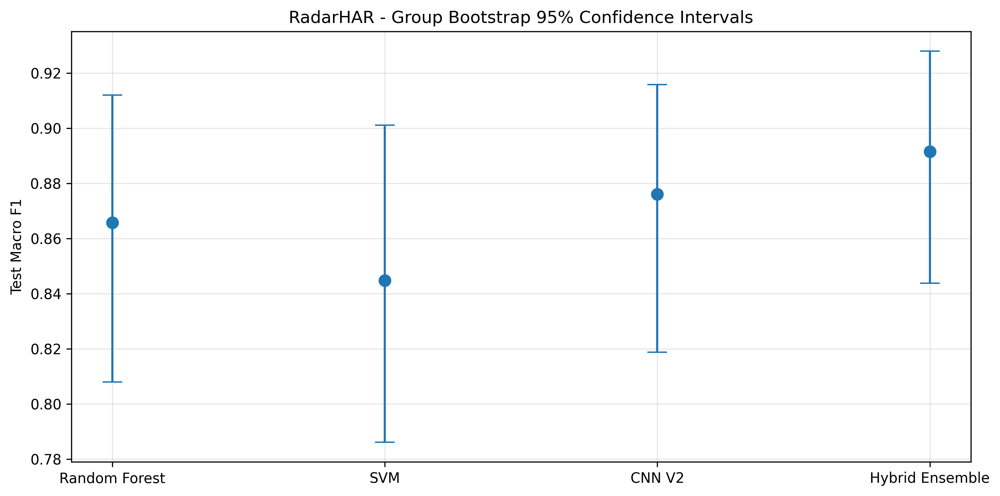

# RadarHAR — Radar-Based Human Activity Recognition

## Overview

RadarHAR is a machine learning and deep learning framework
for human activity recognition using radar micro-Doppler
spectrograms.

The system combines handcrafted radar features with
convolutional neural networks through a weighted
probability-based hybrid ensemble.

## Dataset

- Total recordings: 1,754
- Distinct numerical participant IDs: 72
- Data collections: 7
- Activity classes: 6
- Training recordings: 1,194
- Validation recordings: 301
- Held-out test recordings: 259
- Spectrogram dimensions: 128 x 128
- Handcrafted features: 2,029

## Recognized Activities

1. Walking
2. Sitting down
3. Standing up
4. Drinking water
5. Picking up an object
6. Falling

## Methodology

Raw Radar Signals
→ Signal Processing
→ Micro-Doppler Spectrograms
→ Feature Extraction
→ Machine Learning and Deep Learning
→ Hybrid Ensemble
→ Activity Prediction

## Models

- Random Forest
- Support Vector Machine
- Convolutional Neural Network (CNN V2)
- Hybrid Random Forest-CNN Ensemble

The ensemble uses 65% Random Forest and 35% CNN
prediction probabilities, selected using validation data.

## Held-Out Test Results

| Model | Accuracy | Macro F1 |
|---|---:|---:|
| Random Forest | 85.71% | 86.58% |
| SVM | 83.78% | 84.47% |
| CNN V2 | 86.87% | 87.61% |
| Hybrid Ensemble | 88.42% | 89.16% |

## Confusion Matrices

## Explainable AI

Grad-CAM was implemented to investigate spatial
regions contributing to CNN predictions.

## Statistical Evaluation

- 2,000 group bootstrap samples
- 95% confidence intervals
- Group-wise robustness analysis
- Collection-wise robustness analysis

The hybrid ensemble achieved the highest observed
test performance. However, paired bootstrap confidence
intervals included zero, so statistical superiority
was not established.

## Interactive Demonstration

A Gradio interface enables activity prediction and
spectrogram visualization using preprocessed radar recordings.

## Technologies

Python, NumPy, Pandas, SciPy, Scikit-learn,
TensorFlow, Keras, Matplotlib, Seaborn and Gradio.

## Limitations

- Drinking water and picking up objects exhibit
  overlapping radar signatures.
- Performance varies across participant groups
  and data collections.
- Numerical participant identifiers were used
  for grouped dataset splitting.
- Real-time radar hardware deployment has not
  been validated.
- Further external validation is required.

## Author

Krutarth Valera

Electronics and Communication Engineering

## Disclaimer

This project is an academic research prototype
and is not a certified safety or medical monitoring system.

## Dataset Attribution

Fioranelli, F., Shah, S. A., Li, H.,
Shrestha, A., Yang, S., and Le Kernec, J. (2019).
Radar signatures of human activities.
University of Glasgow.

DOI: https://doi.org/10.5525/gla.researchdata.848

Dataset license: Creative Commons Attribution 4.0.

The original radar recordings were processed into
normalized micro-Doppler spectrograms and handcrafted
features for this independent research project.

## Evaluation Limitations

Identical numerical participant IDs may refer to
different individuals across data collections.
Therefore, the evaluation uses numerical-ID-grouped
splitting rather than verified subject-independent
splitting.

The fall recordings represent simulated falls,
not naturally occurring clinical fall events.

The interactive demonstration uses preprocessed
recordings rather than live radar hardware.
